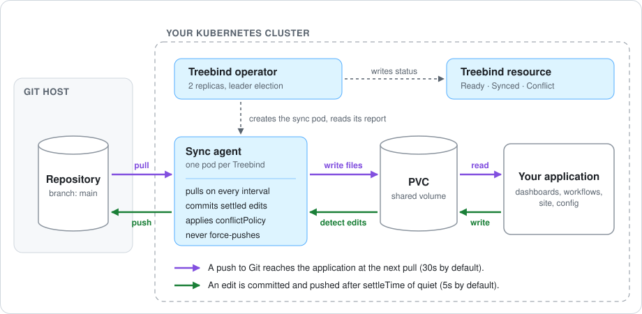

<div align="center">

# Treebind

**Keep a Git repository and a Kubernetes volume in sync, in both directions.**

Declare a `Treebind`. It pulls changes from Git, commits what your application writes, and pushes it back.

[](https://github.com/mohanedmoh/treebind/actions/workflows/ci.yml)
[](https://github.com/mohanedmoh/treebind/actions/workflows/codeql.yml)
[](https://github.com/mohanedmoh/treebind/releases)
[](LICENSE)
[](https://artifacthub.io/packages/helm/treebind/treebind)

[Quickstart](docs/quickstart.md) · [Examples](#examples) · [Documentation](#documentation) · [Discussions](https://github.com/mohanedmoh/treebind/discussions)

</div>

> [!WARNING]
> **Alpha (`v1alpha1`).** Do not use it with data you cannot lose. The API group, `treebind.example.org`, is a placeholder and will change before a stable release. See [status and limitations](#status-and-limitations).

## Why Treebind

Many applications keep their state as plain files: dashboards, workflow definitions, site content, settings. People edit them in the application's own UI, so the edits have no history, no review and no rollback. GitOps tools deploy your manifests, but they do not follow the files an application writes while it runs.

Treebind puts such a directory under Git, **in both directions**:

- A user saves a dashboard in the application, and Treebind commits and pushes it.
- Someone merges a change in Git, and Treebind writes it into the application's directory.

## How it works

<p align="center">
  
</p>

| When... | Treebind... |
| :-- | :-- |
| the application writes a file | waits until the file has been quiet for `settleTime` (5s by default), commits it as one author, and pushes it as a fast-forward |
| someone pushes to the branch | pulls at every `interval` (30s by default) and writes the change into the directory, never over an edit that is not committed yet |
| both sides changed the same file | applies your `conflictPolicy`: `followRemote` (Git wins, your commits are kept in a ref) or `followLocal` (the application wins, in a merge commit that keeps Git's version in the history) |
| it cannot decide safely | stops, says why in `kubectl describe` (`Synced`, `Conflict`), and waits for you |

## Features

- **Two-way, or pull-only.** `bidirectional` commits and pushes the application's edits. `pull` is a read-only mirror of the repository.
- **Safe by default.** It never force-pushes and never writes over an uncommitted local edit. It refuses an update that would remove more than 100 files at once ([deletion guard](docs/deletion-guard.md)), and it never commits files named like secrets, such as `.env` and private keys.
- **Breaks echo loops.** `commit.maxPerHour` (60 by default) stops an application and a repository that answer each other from committing for ever ([echo loops](docs/echo-loops.md)).
- **Syncs exactly what you mean.** `repository.path` syncs one directory of a monorepo, and `paths.include` / `paths.exclude` take `.gitignore` patterns.
- **Observable.** `kubectl get treebind` shows `Ready`, `Synced` and `Conflict`. Each change of `Synced` and `Conflict` is also an event and a Prometheus metric, with alert expressions in the [docs](docs/metrics-and-events.md).
- **Locked down.** Two operator replicas with leader election. Pods run under the `restricted` Pod Security level. The operator never reads a Secret and can be limited to the namespaces you name ([RBAC](docs/rbac.md)). The chart and images are signed, with SBOMs, for amd64 and arm64.

## See it work

A Treebind is one small manifest:

```yaml
apiVersion: treebind.example.org/v1alpha1
kind: Treebind
metadata: {name: dashboards, namespace: monitoring}
spec:
  repository:
    url: ssh://git@github.com/acme/dashboards.git   # change: the ssh address of your repository
    branch: main                                    # change: the branch to follow
    auth:
      sshKeySecretRef: {name: deploy-key, key: id_ed25519}                    # change: your Secret with the deploy key
      knownHostsConfigMapRef: {name: git-known-hosts, key: known_hosts}       # change: your ConfigMap with the host's keys
  target:
    claimName: app-data        # change: an existing PersistentVolumeClaim
    subPath: dashboards        # change: the directory of the claim that is synced
  sync:
    direction: bidirectional
    conflictPolicy: followLocal
```

Write a file the way your application would:

```sh
kubectl -n demo exec app -- sh -c 'echo "Written by the application" > /data/from-the-app.txt'
```

A few seconds later it is a commit on the branch. This is the log on the quickstart's Git server:

```
d3de362 treebind-bot: treebind: sync 1 file(s)
a8b732d Developer: First commit
```

Push a commit from Git, and the file appears in the application's directory within the interval. The [quickstart](docs/quickstart.md) runs the whole loop on a local kind cluster, with a Git server inside the cluster, in about ten minutes. CI runs every command on that page on a kind cluster.

## Install

You need Kubernetes 1.35 or later, [Helm](https://helm.sh), an existing PVC, and a Git repository that you can give an ssh deploy key.

```sh
helm install treebind oci://ghcr.io/mohanedmoh/charts/treebind --version 0.0.1-alpha.5 \
  --namespace treebind-system --create-namespace --wait
```

Each release also publishes an `install.yaml` for `kubectl apply`, and signs the chart and both images ([how to verify a release](docs/releasing.md#verify-a-release)). The [chart README](charts/treebind/README.md) lists what it installs and its values.

## Examples

Each example is a complete, tested walk-through that starts where the quickstart ends.

| Use case | What it shows |
| :-- | :-- |
| [Dashboards edited in the application](docs/examples/dashboards-edited-in-the-application.md) | Both directions, the author and message of the commits, and a dashboard changed in the application and in Git at the same time |
| [A static site that Git deploys and nginx serves](docs/examples/a-static-site-served-by-nginx.md) | `direction: pull`, a read-only mount, and a push that is live within the interval |
| [One directory of a monorepo](docs/examples/one-directory-of-a-monorepo.md) | `repository.path`, commits that change only that directory, and `paths.exclude` |

## Status and limitations

Treebind is alpha, and its releases are pre-releases. Read this before you use it with anything that matters.

- **The API will change.** The group `treebind.example.org` is a placeholder ([#15](https://github.com/mohanedmoh/treebind/issues/15)), and when it changes you will create every Treebind again.
- **Tested on kind.** The tests run on kind clusters of one node with `local-path` storage. `v0.0.1-alpha.5` was also tried by hand on a cluster of two nodes, with local and NFS volumes. **No storage class is listed as supported yet** ([storage support](docs/storage-support.md)).
- **The sync pod is not placed next to the application yet** ([#97](https://github.com/mohanedmoh/treebind/issues/97)). With a `ReadWriteOnce` claim on several nodes, the scheduler can put the two on different nodes.
- **The only credential is an ssh key** ([tokens for https: #58](https://github.com/mohanedmoh/treebind/issues/58)). The agent polls, and webhooks are planned ([#61](https://github.com/mohanedmoh/treebind/issues/61)).
- **Some fields are accepted and ignored.** `spec.placement.mode: sidecar`, `spec.agent.fsGroup` and `spec.agent.resources.claims` are not built yet, and the condition `SpecSupported` says so.

## Documentation

| Topic | Page |
| :-- | :-- |
| Get started | [Quickstart](docs/quickstart.md) · [Examples](#examples) |
| How the sync behaves | [Pulling](docs/pull.md) · [Local changes and commits](docs/local-changes.md) · [Conflicts](docs/conflicts.md) · [Deletion guard](docs/deletion-guard.md) · [Echo loops](docs/echo-loops.md) |
| When something is wrong | [Recovering from a conflict or a rejected push](docs/recovering-from-a-conflict-or-a-rejected-push.md) · [Reading the agent's status](docs/agent-status.md) |
| Running it | [Operator replicas](docs/operator-replicas.md) · [RBAC](docs/rbac.md) · [Pod Security and file ownership](docs/pod-security.md) · [Metrics and events](docs/metrics-and-events.md) · [Deleting a Treebind](docs/deleting-a-treebind.md) |
| Design decisions | [Architecture decision records](docs/adr/README.md) |

## Contributing

Contributions are welcome, and you do not need to know Kubernetes internals to start. Issues labelled [`good first issue`](https://github.com/mohanedmoh/treebind/labels/good%20first%20issue) are self-contained, with named files and an acceptance test. A maintainer gives a first response within three working days.

- Start with [CONTRIBUTING.md](CONTRIBUTING.md). Commits are signed off (`git commit -s`), and [docs/development.md](docs/development.md) gets you a working setup.
- Ask questions and share ideas in [Discussions](https://github.com/mohanedmoh/treebind/discussions).
- **Storage reports wanted.** Tried Treebind on your storage class? The [storage support matrix](docs/storage-support.md) fills in from what people report.
- Decisions are made as described in [GOVERNANCE.md](GOVERNANCE.md). Report security problems privately, as [SECURITY.md](SECURITY.md) describes.

## License

Apache License 2.0. See [LICENSE](LICENSE) and [NOTICE](NOTICE).
